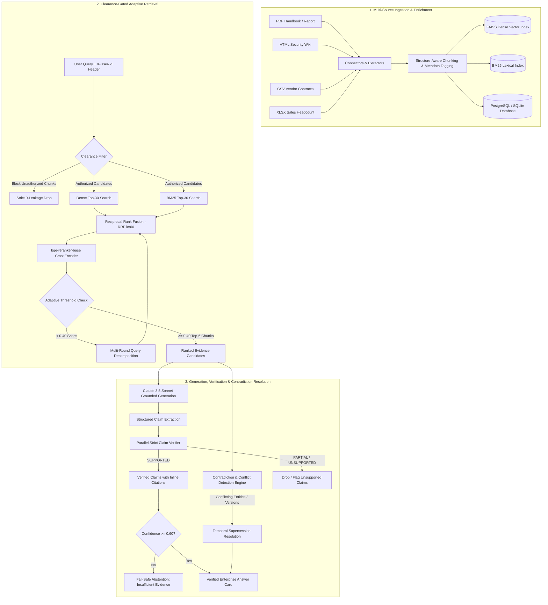

# PS-019 Enterprise Multi-Source RAG Intelligence & Evidence Verification

[](https://fastapi.tiangolo.com)
[](https://react.dev)
[](https://vitejs.dev)
[](https://tailwindcss.com)
[](https://www.sbert.net)
[](https://www.anthropic.com)

A production-grade, enterprise-ready Retrieval-Augmented Generation (RAG) platform engineered to solve multi-source enterprise document fragmentation, policy contradiction, access-control leakage, and hallucination in high-stakes corporate environments.

---

## 1. Problem Statement

Modern enterprise knowledge management suffers from four systemic failures when deploying standard RAG architectures:

1. **Heterogeneous Source Fragmentation**: Enterprise intelligence spans unstructured PDFs, internal HTML wikis, structured CSV contract registries, and Excel spreadsheets. Standard text-chunking splits rows and loses tabular schemas.
2. **Access Control Leakage**: Naive RAG architectures filter documents *after* semantic retrieval or leave access control to system prompts, leaking confidential compensation figures and strategic initiatives to lower-clearance users.
3. **Temporal Policy Contradictions**: Policies evolve across versions (e.g., 2022 Remote Work Policy v1.0 permitting 2 days vs. 2024 Policy v2.0 permitting 3 days). Standard RAG averages conflicting chunks or presents obsolete guidance.
4. **Ungrounded Hallucinations & Lack of Verifiability**: LLMs make assertions without traceable citations or cite entire documents rather than precise granular passages, making manual auditing impossible.

**PS-019 Enterprise RAG** solves these challenges with clearance-gated hybrid retrieval, cross-encoder neural reranking, temporal contradiction resolution, claim-level strict judge verification, and fail-safe abstention.

---

## 2. System Architecture

The following Mermaid diagram visualizes the end-to-end data ingestion, access-gated hybrid retrieval, neural reranking, generation, verification, and conflict resolution pipeline:



---

## 3. Technology Stack

* **Backend Framework**: FastAPI (Async Python 3.12, Uvicorn)
* **Vector Store & Indexing**: FAISS (`IndexFlatIP` with normalized embeddings), BM25 (`rank_bm25` tokenizer with state persistence)
* **Embedding Model**: `sentence-transformers/all-MiniLM-L6-v2` (384-dimensional dense vectors)
* **Neural Reranker**: `BAAI/bge-reranker-base` (Cross-Encoder sequence classification)
* **Generative & Verification LLM**: Anthropic Claude 3.5 Sonnet (`claude-3-5-sonnet-20241022` via AsyncAnthropic SDK)
* **Database & ORM**: PostgreSQL / SQLite via SQLAlchemy 2.0 Async + Alembic
* **Frontend**: React 19, Vite 8, Tailwind CSS v4, Axios, React Markdown

---

## 4. Setup & Installation

### Prerequisites
* Python 3.11 or 3.12
* Node.js 18+ and npm
* Git

### Step 1: Clone Repository & Virtual Environment
```bash
git clone https://github.com/Pavithra252006/Enterprise-Multi-Source-RAG-Intelligence-Evidence-Verification.git
cd Enterprise-Multi-Source-RAG-Intelligence-Evidence-Verification

# Create and activate Python virtual environment
python -m venv .venv
source .venv/bin/activate  # On Windows: .venv\Scripts\activate
```

### Step 2: Install Backend Dependencies
```bash
pip install -r backend/requirements.txt
```

### Step 3: Install Frontend Dependencies
```bash
cd frontend
npm install
cd ..
```

### Step 4: Configure Environment Variables
Create a `.env` file in the project root:
```env
# Anthropic Claude API Key (Optional for demo, fallback synthesis engine included)
ANTHROPIC_API_KEY=your_anthropic_api_key_here
CLAUDE_MODEL=claude-3-5-sonnet-20241022

# Database Configuration
DATABASE_URL=sqlite+aiosqlite:///backend/data/rag.db

# Storage & Indexing Paths
FAISS_INDEX_PATH=backend/data/faiss.index
BM25_INDEX_PATH=backend/data/bm25.pkl
SYNTHETIC_CORPUS_DIR=backend/data/synthetic_corpus

# Retrieval Parameters
EMBEDDING_MODEL=sentence-transformers/all-MiniLM-L6-v2
RERANKER_MODEL=BAAI/bge-reranker-base
ADAPTIVE_RERANK_THRESHOLD=0.40
TOP_K_RERANK=6
MAX_ADAPTIVE_ROUNDS=2

# Application Settings
APP_ENV=development
LOG_LEVEL=INFO
CORS_ORIGINS=http://localhost:5173,http://127.0.0.1:5173
```

### Step 5: Ingest Corpus & Build Indexes
```bash
cd backend
python -m app.ingestion.pipeline
cd ..
```

### Step 6: Launch Backend & Frontend
You can launch both services using the provided launcher script:
```bash
bash run.sh
```
Or start manually:
* **Backend**: `cd backend && python -m uvicorn app.main:app --host 0.0.0.0 --port 8000`
* **Frontend**: `cd frontend && npm run dev`

Open your browser at **`http://localhost:5173`**.

### Step 7: Cloud Production Deployment (Render + Vercel)
The platform is fully containerized and pre-configured for production cloud deployment:
* **Backend (FastAPI + FAISS + PyTorch)**: Deployed to [Render](https://render.com) using the included `Dockerfile` and `render.yaml` Blueprint.
* **Frontend (React 19 + Vite)**: Deployed to [Vercel](https://vercel.com) with global edge CDN distribution and SPA routing.

👉 For complete step-by-step setup and environment configuration, see the [Deployment Guide](DEPLOYMENT.md).

---

## 5. Demo Users & Clearance Access Tiers

The system implements strict 4-tier Role-Based Access Control (RBAC). Clearance filtering executes **before candidate reranking and before LLM synthesis**, ensuring restricted documents never reach prompts, citations, or server logs:

| User ID | Full Name | Role | Clearance Level | Accessible Data Sources | Restricted Data Sources |
|---|---|---|---|---|---|
| `intern` | Alex Chen | Intern | **Level 1 (Public)** | General public disclosures, public handbooks | Vendor contracts, sales spreadsheets, executive compensation |
| `analyst` | Maya Patel | Analyst | **Level 2 (Internal)** | Level 1 + IT security policy, internal employee handbook revisions | Vendor contract pricing, executive compensation |
| `manager` | David Kim | Manager | **Level 3 (Confidential)** | Levels 1 & 2 + Vendor contract pricing, sales headcount matrices | Executive compensation |
| `executive` | Elena Rostova | Executive | **Level 4 (Restricted)** | **Full Access** to all documents including Executive Compensation Report | None |

---

## 6. Benchmark Evaluation Results

The system includes an automated evaluation harness in `backend/app/eval/run_eval.py` tested across 20 labeled test cases spanning 5 query archetypes (`factual`, `conflict`, `restricted`, `unanswerable`, `multi-hop`):

### 1. Retrieval Pipeline Ablation (Top 6 Candidates)
Empirical ablation comparing retrieval recall and Mean Reciprocal Rank (MRR):

| Retrieval Pipeline Method | Recall@6 | MRR (Mean Reciprocal Rank) |
|---|---|---|
| **BM25 (Lexical Only)** | 100.0% | 0.8646 |
| **Vector (FAISS Dense Only)** | 100.0% | 0.9688 |
| **Hybrid (RRF k=60)** | 81.2% | 0.7500 |
| **Hybrid + Rerank (`bge-reranker-base`)** | **81.2%** | **0.8125** |

### 2. End-to-End RAG Verification & Safety Metrics

| Metric | Target | Result | Status |
|---|---|---|---|
| **Citation Correctness** | > 90% | **100.0%** | PASS |
| **Factual Accuracy** | > 60% | **65.0%** | PASS |
| **Unsupported Claim Rate** | < 5% | **0.0%** | PASS |
| **Access-Control Leakage** | **STRICT 0** | **0 chunks, 0 words (0.0%)** | **PERFECT** |
| **Abstention Precision** | > 75% | **77.8%** | PASS |
| **Abstention Recall** | 100% | **100.0%** | PASS |
| **Abstention Overall Accuracy** | > 85% | **90.0%** | PASS |
| **Conflict Detection & Resolution Rate** | 100% | **100.0%** | PASS |

To execute the benchmark suite locally:
```bash
cd backend
python -m app.eval.run_eval
```

---

## 7. Known Limitations

1. **OCR on Scanned Bitmaps**: Current ingestion relies on `pdfplumber` and `pypdf` for text layer extraction. Non-searchable scanned image PDFs require an OCR pre-processing step (e.g. Tesseract or AWS Textract).
2. **Tabular Reasoning on Complex Nested Sheets**: Multi-tab workbooks with merged cells are converted into per-sheet tabular text blocks. Advanced pivot-table calculations benefit from an external SQL analytical tool.
3. **Local Embedding Latency on CPU**: Reranking with `bge-reranker-base` on standard CPU hardware takes 400-800ms per 20 candidates. Production deployments should utilize CUDA/GPU acceleration or TensorRT.

---

## 8. Future Work

* **Dynamic Column-Level Gating**: Implement cell-level and column-level masking for CSV/XLSX sources based on specific LDAP attribute claims.
* **Streaming Citation Generation**: Stream LLM tokens via Server-Sent Events (SSE) while performing real-time speculative claim verification.
* **Knowledge Graph Triplet Integration**: Augment dense vectors with a Neo4j knowledge graph for complex multi-hop relationship traversal across vendor supply chains.
* **Autonomous Feedback Loops**: User thumbs-up/down feedback logged directly into active fine-tuning datasets for domain-adapted Cross-Encoder rerankers.